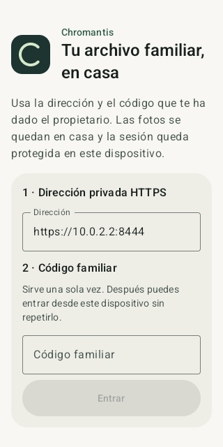
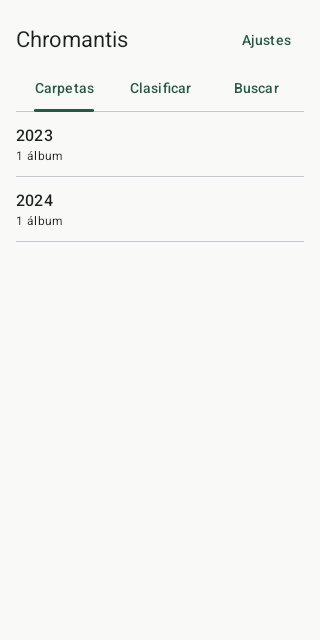
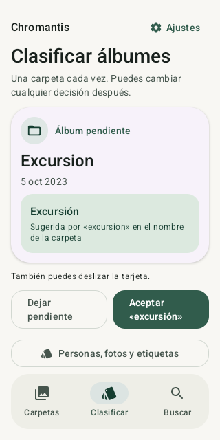
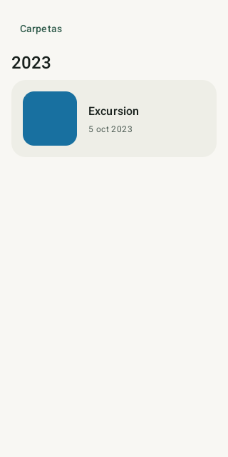
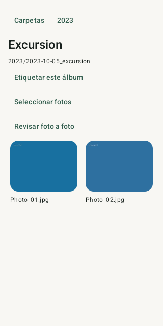
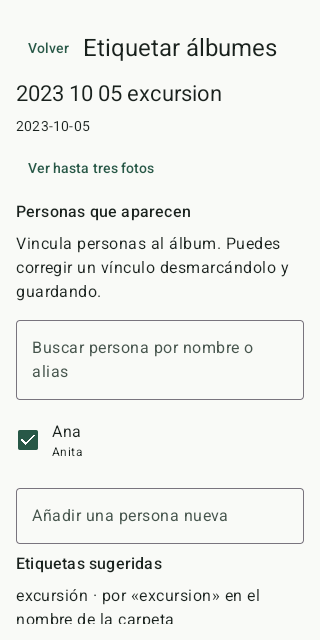
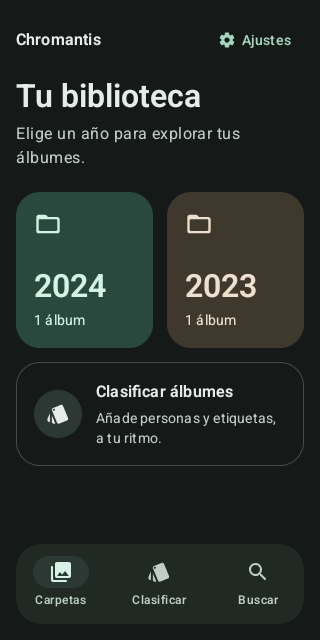
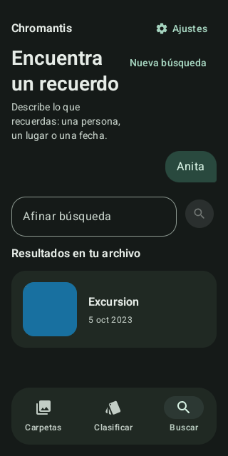

Chromantis para Android está en versión preliminar y requiere Android 8.0 o posterior. Se conecta a tu propio servidor de Chromantis por HTTPS privado y usa un [código de acceso familiar](../start/private-access.md#invita-a-un-familiar-sin-telegram).

**Cómo conseguir el APK.** Descarga el último APK de prueba verificado desde el artefacto del workflow o compílalo localmente siguiendo las instrucciones de abajo.

## Qué puedes hacer

- **Carpetas** muestra años, álbumes y una galería paginada. Si el servidor tiene miniaturas activadas, la app carga las visibles. Toca una foto para abrir el original. Toca **Carpetas**, el año o el álbum en la ruta para volver a ese nivel. **Continuar en…** abre la última galería visitada desde Carpetas en la última página que se cargó. El acceso directo se guarda en el dispositivo y se borra cuando termina la sesión familiar.
- **Clasificar** muestra una tarjeta por álbum. Desliza a la derecha para aceptar la etiqueta que ves o a la izquierda para dejar el álbum pendiente. También puedes pulsar los botones. En **Personas, fotos y etiquetas** puedes buscar personas por nombre o alias, ver algunas fotos bajo demanda o corregir decisiones. Para editar un álbum ya revisado, abre **Etiquetar este álbum** en la galería.
- **Buscar** empieza con palabras del álbum o el nombre de una persona. Escribe después `antes de 2020` o `con Ana` para acotar esos resultados. Si el nombre del álbum es ambiguo, elige uno de los candidatos. Se usan las reglas de búsqueda locales. Para combinar tema, persona y fecha en la primera consulta, prueba `fotos de la playa con Ana antes de 2020`. Esta forma busca personas vinculadas al álbum y admite sus alias. Pulsa **×** en un filtro de persona, año o álbum para quitarlo y conservar el resto.

En **Ajustes** puedes elegir claro, oscuro o seguir el tema de Android. La elección se guarda en el dispositivo.

Los seguimientos de una búsqueda de álbumes también admiten `con Ana y Luis` o nombres separados por comas. El servicio local actualizado exige vínculos de ambas personas al álbum, resuelve sus alias y conserva la búsqueda anterior si algún nombre no existe. Cada persona mantiene un filtro independiente para quitarlo.

## Un recorrido breve

Estas capturas muestran las pantallas Compose rediseñadas en una actividad de pruebas desechable, con fotos sintéticas. Otro ejemplo independiente comprueba que se puede buscar y etiquetar con el archivo desconectado. No contienen datos familiares. Las barras del sistema y la posición del teclado pueden variar en tu móvil.

1. **Conecta con el archivo familiar.** Escribe la dirección privada de Chromantis y el código de un solo uso que te dé el propietario. La pantalla explica que se exige HTTPS, que las fotos permanecen en el servidor doméstico y que la sesión posterior queda protegida en este dispositivo. Chromantis cifra esa sesión guardada con Android Keystore y el propietario puede revocarla.



2. **Abre Carpetas.** La biblioteca muestra los años en tarjetas con su número de álbumes indexados. Elige un año y después un álbum. Las tres secciones principales están abajo, al alcance del pulgar. La biblioteca por años no abre fotos.



3. **Clasifica una carpeta.** **Clasificar** presenta un álbum pendiente en una tarjeta centrada. La etiqueta propuesta explica qué texto del nombre de la carpeta la originó. El gesto es opcional: aceptar y dejar pendiente tienen botones grandes, y el editor completo de personas, fotos y etiquetas está a un toque.



Esta primera pasada usa solo el índice y el nombre de la carpeta. Las fotos se solicitan al abrir el editor detallado; la tarjeta rápida no abre imágenes ni consulta ningún modelo.

4. **Abre un álbum.** Las tarjetas muestran un título legible, la fecha y una portada cuando está disponible.



Las portadas se cargan solo para los álbumes visibles al abrir un año o un resultado de búsqueda. Reutilizan la caché de miniaturas; si no están disponibles, aparece una carpeta.



5. **Etiqueta un álbum.** Abre **Etiquetar este álbum**, selecciona a una persona por su nombre o alias y guarda. La selección se confirma visualmente y el botón Guardar sigue visible mientras recorres el formulario. Busca `Anita` desde **Buscar** para encontrarlo. El vínculo se refiere al álbum, no confirma la presencia en cada foto. Las fotos siguen bajo demanda.



6. **Elige la apariencia.** **Ajustes → Oscuro** cambia las mismas pantallas. También puedes elegir claro o seguir el sistema.



7. **Pide un recuerdo.** **Buscar** comienza con ejemplos que puedes usar o sustituir. Tu petición permanece visible sobre los resultados. Añade un detalle en el mismo campo o quita un filtro de persona, año o álbum sin empezar de nuevo.



Esta pantalla usa las reglas locales deterministas existentes. No indica que un modelo haya interpretado la petición. **Fotos por persona** sigue siendo una búsqueda exacta y separada por vínculos a fotos, disponible desde la pantalla inicial de Buscar.

El recorrido Compose pulsa los controles reales de entrada, navegación, carga de portadas, guardado sin desplazar la pantalla hasta el botón, búsqueda por alias y apariencia. Otra prueba abre la actividad exportada, entra usando sus preferencias cifradas reales, visita un álbum, recrea la actividad, la cierra y lanza una actividad nueva. Después usa **Continuar en…** para volver al álbum y cierra la sesión. Esto cubre la recreación y un lanzamiento nuevo en el emulador; no simula la muerte completa del proceso ni sustituye la prueba en un móvil físico.

## Protección de la sesión

La app cifra la sesión familiar guardada con AES-GCM y una clave del dispositivo en [Android Keystore](https://developer.android.com/privacy-and-security/keystore). El cifrado también autentica la dirección del NAS. Las sesiones existentes se migran al abrir la app y se elimina la preferencia anterior en texto plano tras cifrarla. Estas preferencias siguen excluidas de las copias de seguridad y de la transferencia entre dispositivos.

Si la clave no está disponible o el contenido guardado está dañado, pide otro código familiar. No se usa almacenamiento en texto plano como alternativa. Si falla el guardado de una sesión nueva, la app avisa y permite continuar durante esa ejecución. Cerrar sesión o recibir una revocación elimina la sesión guardada y el acceso al último álbum. La caducidad y revocación del servidor siguen aplicándose.

Esto protege el valor guardado, no un dispositivo o proceso comprometido. No añade peticiones biométricas, servicios externos ni carga al NAS. La creación y recuperación de claves en Keystore aún requieren comprobación en un dispositivo físico. Con el ejemplo sintético, entra, reinicia y comprueba que se recupera la sesión; cierra sesión y verifica que hace falta otro código. Solo con datos sintéticos y una compilación de depuración, inspecciona las preferencias de la app: debe existir `session_encrypted`, sin un valor `session` en texto plano. Repite tras actualizar, sin desinstalar y con la misma clave de firma, una versión que guardara el valor antiguo `session`. No copies credenciales reales a los informes.

## Comprobar el índice

Abre **Ajustes → Estado del índice**. Muestra si la última indexación está en curso, completada o fallida y la fecha de la última indexación correcta que comunica el servidor. **Actualizar estado** vuelve a consultar; la pantalla no consulta en segundo plano ni abre fotos. Si no hay historial, lo indica. Un fallo no sustituye la fecha de la última indexación correcta.

La app familiar no permite iniciar una indexación. El propietario puede usar **Administración → Buscar carpetas nuevas** en el [panel web local](../operate/maintenance.md). Los controles nativos de propietario siguen pendientes; el permiso familiar de etiquetado conserva su alcance.

## Etiqueta fotos individuales

1. Abre una galería y pulsa **Seleccionar fotos** o mantén pulsada una foto. Marca las fotos de la página actual.
2. Pulsa **Etiquetar fotos**. Elige **Añadir** o **Quitar** y selecciona una persona existente por su nombre o alias, escribe una etiqueta de una sola palabra o haz ambas cosas. Confirma para aplicar el cambio a la selección. Puedes salir con Atrás antes de guardar.
3. En **Buscar → Fotos por persona**, escribe un nombre o alias. Aparecerán las fotos en las que se haya confirmado esa persona. La búsqueda de álbumes sigue incluyendo los vínculos al álbum.

Para acotar las fotos confirmadas, escribe una etiqueta manual de una palabra en **Etiqueta manual opcional** y busca. Por ejemplo, usa `Anita` y `romería`. Borra la etiqueta y vuelve a buscar para ver todas las fotos confirmadas de esa persona. Al cambiar la persona o la etiqueta se empieza por la primera página de resultados. Este filtro requiere el servicio local actualizado que admite `person` junto con `tag`.

Para editar necesitas permiso de etiquetado. Si una foto indexada cambia durante la edición, actualiza la galería y vuelve a seleccionar las fotos.

Con las miniaturas activadas, **Revisar foto a foto** te deja elegir a una persona y recorrer la página actual de la galería. Desliza a la derecha para marcar la foto o a la izquierda para saltarla. Los botones hacen lo mismo. **Deshacer última decisión** vuelve a la foto anterior. **Guardar** aplica los vínculos nuevos en un solo lote. Salir de la revisión descarta el borrador. Si una miniatura falla, puedes saltar la foto.

Falta probar el recorrido completo en un teléfono físico actual. El cliente nativo de `android/` usa Kotlin y Jetpack Compose con Material 3. El servicio compartido gestiona el acceso al archivo, los permisos, la indexación y el etiquetado.

## Compila e instala

### Descarga el APK de prueba verificado

Abre el [flujo de verificación de Android](https://github.com/42Azul/chromantis/actions/workflows/android.yml), elige la última ejecución correcta de `main` y descarga `chromantis-debug-<commit>` en **Artifacts**. GitHub exige iniciar sesión para descargar artefactos de los workflows. El ZIP contiene `Chromantis-debug.apk` y `SHA256SUMS.txt` y caduca a los siete días.

Comprueba la descarga antes de instalarla:

```bash
sha256sum --check SHA256SUMS.txt
adb install -r Chromantis-debug.apk
```

Este APK de prueba usa la clave persistente de CI. Para pasar desde un APK firmado con una clave anterior de depuración, reinstala la app e inicia sesión de nuevo una vez. Los siguientes APK de este flujo se pueden instalar como actualizaciones.

### Compílalo localmente

En tu ordenador necesitas JDK 17 o 21, Gradle 8.13, Android SDK Platform 36 y Build Tools 36.0.0. Apunta `ANDROID_HOME` al SDK. Desde la raíz del repositorio:

```bash
gradle -p android spotlessCheck testDebugUnitTest assembleDebug lintDebug
adb install -r android/build/outputs/apk/debug/Chromantis-debug.apk
```

El APK de depuración se firma con la clave de depuración local. Ábrelo con una dirección HTTPS privada a la que llegue el móvil y un código familiar. Si usas un proxy inverso HTTPS, sigue la [configuración de acceso privado](../start/private-access.md). HTTP sin cifrar está desactivado. El APK de depuración admite certificados instalados por el usuario para las pruebas locales. El APK de distribución usa los certificados de confianza del sistema. Para formatear el código Kotlin con la versión fijada de ktfmt, ejecuta `gradle -p android spotlessApply`.

## Prueba Android Keystore

Con un emulador desechable o dispositivo de pruebas conectado mediante `adb`, ejecuta:

```bash
gradle -p android connectedDebugAndroidTest
```

Cuatro pruebas instrumentadas usan el proveedor real de Android Keystore: persistencia cifrada con una clave no exportable, migración de preferencias antiguas, rechazo de otro origen y recuperación tras borrar la clave. Cada prueba crea un alias y un archivo de preferencias aleatorios exclusivos y elimina solo esos recursos. No necesitan NAS, fotos, credenciales familiares ni claves de firma de distribución.

El [flujo de verificación de Android](https://github.com/42Azul/chromantis/actions/workflows/android.yml) ejecuta estas pruebas en un emulador API 36 junto con formato Kotlin, pruebas JVM, compilación de los APK de depuración y lint. Tras un `push` correcto conserva únicamente el APK de depuración y su checksum durante siete días; no usa caché de compilación y se omite si el repositorio pasa a privado. El emulador comprueba la integración con la plataforma; no demuestra protección de claves por hardware ni sustituye el recorrido en un teléfono físico descrito arriba.

### Cliente nativo por HTTPS

La CI también prueba el cliente HTTP Kotlin contra el servicio Python real con un archivo sintético desconectado. Comprueba el código de un solo uso, la recuperación de la sesión cifrada, la paginación, el vínculo con Ana, la búsqueda por alias y el rechazo tras cerrar sesión. Es una prueba de integración entre cliente y servicio; el recorrido visual sigue pendiente.

Para repetirla en un emulador desechable, crea el certificado temporal indicado más abajo y ejecuta este programa en lugar del ejemplo interactivo:

```bash
PYTHONPATH=src python tests/android_instrumentation_fixture.py \
  --cert "$fixture_dir/cert.pem" --key "$fixture_dir/key.pem" \
  --config android/src/androidTest/assets/fixture.json
```

En otra terminal, ejecuta `gradle -p android connectedDebugAndroidTest`. Reinicia el programa antes de cada ejecución para generar otro código de un solo uso. El programa solo escucha en loopback del anfitrión y prepara un recurso ignorado para el APK de pruebas. Solo el proceso de pruebas confía en ese certificado generado; se mantiene la verificación del nombre del servidor y no cambian las reglas de certificados de la app. Ctrl+C elimina el recurso y el ejemplo temporal. Sin ese recurso se omiten las pruebas del cliente y Compose; las cuatro de Keystore se siguen ejecutando. Usa únicamente emuladores desechables y credenciales sintéticas.


Para exportar las nueve capturas sintéticas en un emulador desechable API 29+, añade `-Pandroid.testInstrumentationRunnerArguments.captureScreenshots=true` al comando Gradle. La prueba escribe únicamente sus PNG generados en `Download/chromantis-compose/`; sobreviven a la limpieza de la app de pruebas. Una ejecución normal no guarda capturas en almacenamiento compartido. La CI comprueba las cabeceras PNG antes de exportarlas.

## Firma un APK para distribuirlo en privado

Crea una clave de firma una sola vez y guárdala fuera del repositorio. Copia `android/keystore.properties.example` a `android/keystore.properties`. Indica la ruta absoluta de la clave y sustituye los valores de ejemplo. Git ignora el archivo de configuración y los archivos `.jks` y `.keystore`. Compila y verifica el resultado:

```bash
keytool -genkeypair -v -keystore /private/path/to/chromantis-release.jks \
  -alias chromantis -keyalg RSA -keysize 3072 -validity 10000
gradle -p android spotlessCheck testDebugUnitTest assembleRelease lintRelease
apksigner verify --verbose android/build/outputs/apk/release/Chromantis-release.apk
```

Guarda una copia privada del almacén de claves y de las contraseñas. Para instalar una actualización en Android necesitas firmarla con la misma clave. En CI u otro equipo de confianza puedes prescindir de `keystore.properties` y definir `CHROMANTIS_KEYSTORE_PATH`, `CHROMANTIS_KEYSTORE_PASSWORD`, `CHROMANTIS_KEY_ALIAS` y `CHROMANTIS_KEY_PASSWORD`. Si Gradle no encuentra `assembleRelease`, comprueba que los cuatro valores estén configurados. Sin ellos se desactiva la variante de distribución y el comando general `assemble` solo genera el APK de depuración.

## Prueba con un archivo sintético

Para probar en un emulador, instala el extra de miniaturas, que incluye Pillow. Genera un certificado temporal para el alias del anfitrión y ejecuta el ejemplo sin el NAS:

```bash
fixture_dir=$(mktemp -d)
openssl req -x509 -newkey rsa:2048 -nodes -days 1 -subj /CN=Chromantis-Fixture \
  -addext 'subjectAltName=IP:10.0.2.2' \
  -keyout "$fixture_dir/key.pem" -out "$fixture_dir/cert.pem"
PYTHONPATH=src python tests/android_fixture.py \
  --cert "$fixture_dir/cert.pem" --key "$fixture_dir/key.pem"
```

Instala el certificado temporal como CA de usuario de confianza en un emulador de pruebas. Usa la dirección `https://10.0.2.2:8443` y el código de un solo uso que imprime el ejemplo. Abre 2024, pasa a la segunda página de la galería, abre una foto y gira el dispositivo. Comprueba que sigue abierta la misma foto y que al volver atrás aparece la segunda página. Relanza la app para comprobar que conserva la sesión.

Para comprobar el mismo servidor de prueba por HTTPS sin abrir la app, ejecuta `PYTHONPATH=src python -m unittest discover -s tests -p test_android_fixture.py -v`.

En **Clasificar**, desliza la primera tarjeta a la izquierda y usa **Volver al principio** al final de la cola para recuperarla. En **Carpetas**, abre el álbum de playa de 2024 y pulsa **Etiquetar este álbum**. Busca `Anita`, selecciona a Ana y guarda. En **Buscar**, escribe `fotos de la playa con Anita antes de 2025` y comprueba que aparecen los dos filtros. Quita el año con **×** y comprueba que sigue aplicado el filtro de persona.

Repite con un ejemplo nuevo en modo `--index-only`. Desliza a la derecha sobre una etiqueta sugerida. La app muestra la siguiente sugerencia del mismo álbum o pasa al siguiente cuando terminas. Abre el álbum desde **Carpetas** y comprueba la decisión en **Etiquetar este álbum**. Prueba los botones y los gestos con el archivo sintético desconectado.

Para comprobar el etiquetado individual, selecciona las fotos 1 y 3 del álbum de 2024 y añade a Ana. Busca `Anita` en **Fotos por persona** y comprueba que salen exactamente esas dos.

Añade la etiqueta manual `romería` a las fotos 2 y 3. Busca `Anita` con `ROMERIA` en el campo de etiqueta opcional y comprueba que solo aparece la foto 3: la primera tiene a Ana sin esa etiqueta y la segunda tiene la etiqueta sin Ana. Cambia la etiqueta por `unknown` y comprueba que el resultado está vacío. Borra la etiqueta y busca de nuevo para recuperar las fotos 1 y 3. Quita a Ana de la primera y repite la búsqueda; solo debería aparecer la tercera. Pulsa Ctrl+C para eliminar el índice temporal y las fotos sintéticas.

Para probar los gestos, arranca un ejemplo nuevo con el archivo sintético conectado. En **Revisar foto a foto**, elige a Ana, marca la foto 1, salta la 2, marca la 3, deshaz la última decisión y salta la 3. Guarda y comprueba que la búsqueda confirmada devuelve solo la foto 1. Repite con el editor por lotes y compara el tiempo y los errores de selección.

Para comprobar la ruta de carpetas, abre la segunda página de la galería de 2024 y entra en una foto. Toca el álbum en la ruta para volver a la segunda página y luego **Carpetas** para llegar a la lista de años en un toque. Cierra y vuelve a abrir la app y usa **Continuar en…** para regresar a la segunda página. Si al reindexar se eliminó esa página, el acceso directo abre la primera disponible.

Para probar la revocación, ejecuta este comando en otra terminal con la ruta **SQLite** y el **Family access ID** que imprime el servidor de prueba. Después, abre otro año en la app y comprueba que pide un código nuevo.

```bash
SOURCE_TYPE=local SOURCE_ROOT=/tmp SQLITE_PATH=/tmp/chromantis-android-EXAMPLE/index.db \
  python scripts/family_access.py revoke 1
```

En Android 10 o posterior, abre una foto y pulsa **Guardar original** para guardar una copia en **Pictures/Chromantis**. La app descarga el original bajo demanda, con un límite de 32 MiB.

En el visor, pulsa **Compartir** para abrir el menú de Android con el original. Elige una aplicación y confirma allí el envío. El visor prepara una copia temporal privada y admite originales de hasta 32 MiB.

En la galería, pulsa **Seleccionar fotos** y marca hasta diez. **Compartir selección** prepara los originales (32 MiB en total) y abre el menú de Android. Puedes cancelar la preparación o cambiar la selección y reintentar si supera el límite.

En Android 10 o posterior, **Guardar selección** copia las fotos marcadas a **Pictures/Chromantis**. Cada intento admite hasta diez fotos y 32 MiB. Si cancelas o falla un archivo, mantén abierta la selección y reintenta para guardar los que falten.

## Comprobaciones en un teléfono físico

Usa la misma APK para todas las filas y anota su compilación o commit, la versión de Android, el modelo del teléfono y la fecha. Usa una invitación familiar desechable y fotos sintéticas en una red privada. Omite direcciones, códigos y contenido de las fotos en los resultados. Anota **Correcto**, **Fallo** o **No aplica** en cada fila y explica cuándo no aplica. Deja abierta cada comprobación obligatoria hasta realizarla.

| Comprobación | Resultado esperado | Resultado |
| --- | --- | --- |
| Canjea una invitación y vuelve a probarla en otra sesión. | La primera entrada funciona y se rechaza el segundo canje. | |
| Abre la segunda página de la galería, gira el teléfono y vuelve desde una foto. | Se conservan el álbum y la página. | |
| Abre otra app, termina el proceso de Chromantis en segundo plano e inicia Chromantis desde su icono. Anota si el proceso llegó a terminar. | La sesión sigue activa y **Continuar en…** abre la página guardada. | |
| Revoca la sesión de prueba y abre otro año. | La siguiente petición protegida pide un código nuevo. Una nueva invitación recupera el acceso. | |
| Desconecta el Wi-Fi o detén el servidor de prueba al abrir una miniatura sin caché y después restablece la conexión. | Se muestra el fallo y el reintento carga la miniatura. | |
| Deniega el acceso a la red local si Android ofrece ese control y vuelve a concederlo. | La app se recupera y puede abrir una foto al restaurar el acceso. | |
| Explora un año con dos ramas en un archivo de prueba que incluya ambas. | Los dos álbumes con el mismo título se abren como galerías distintas, incluido el de una página posterior. | |
| Abre una portada, guarda un original y una selección, y comparte una foto sintética desde el menú de Android. | Se ve la portada, los archivos guardados se abren en la galería y la app receptora abre la foto compartida. | |

Para cada fallo, anota los pasos mínimos, lo que apareció en pantalla y quién hará el seguimiento. Deja pendiente cualquier fila que el archivo de prueba o el dispositivo no permitan comprobar.
