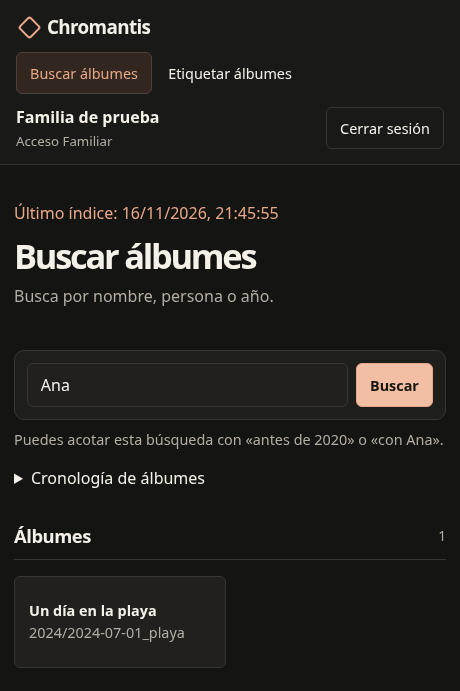
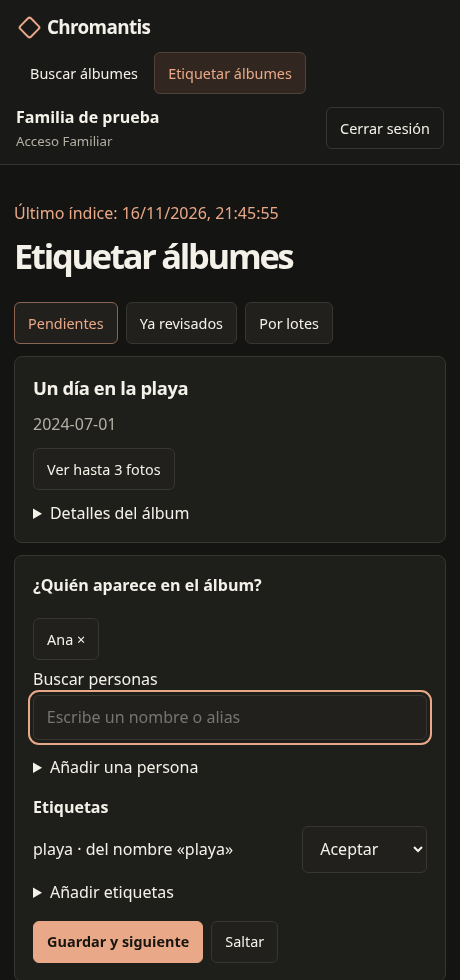
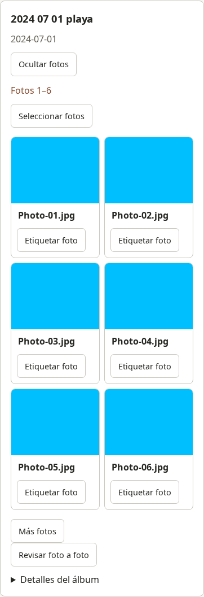
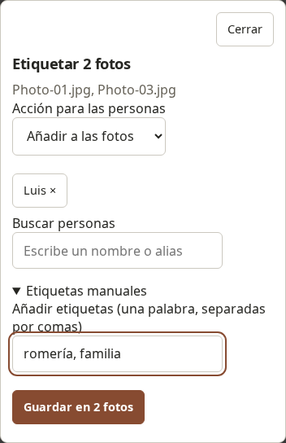
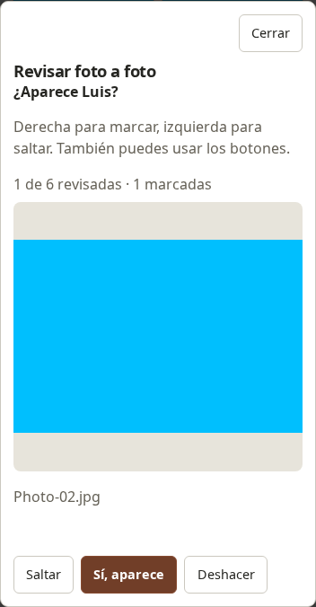

En **Aspecto**, elige **Sistema**, **Claro** u **Oscuro**. La elección se guarda en este navegador. **Sistema** sigue el aspecto del dispositivo.

Abre la dirección local de Chromantis e [inicia sesión](../start/private-access.md). Puedes usar un móvil o un ordenador.

Las capturas muestran la web en una pantalla de tamaño móvil con un archivo de ejemplo. En las capturas con tema claro se usan bloques azules como fotos y nombres ficticios.

## Encuentra un álbum

Pulsa **Explorar por año** para ver los años del índice y sus recuentos de álbumes y fotos. Abre un año y después un álbum. Con **Página siguiente** puedes ver más álbumes y con **Volver a años** regresas a la lista de años. Tras revisar un álbum, **Volver a resultados** recupera la misma página. Puedes recorrer el índice con el archivo fotográfico desconectado.

En una sesión familiar, abre **Buscar álbumes** para navegar por año o buscar por palabras de la carpeta, título, alias, lugar o persona. Prueba `playa 2024` o `Ana`. Abre un álbum para ver sus fotos y usa el visor para abrir o descargar un original. La [caché opcional de miniaturas](../operate/maintenance.md#carga-miniaturas-solo-cuando-hagan-falta) aligera la galería en el móvil.

Usa la cronología para buscar por lugar o fecha. La fecha puede venir de la carpeta indexada o de una corrección guardada. Si están disponibles, el visor indica por separado la fecha de captura y la de modificación del archivo.

Puedes acotar la búsqueda con `antes de 2020`, `solo 2019` o `con Ana`. Una vez aplicado el filtro, el campo vuelve a mostrar la consulta de partida. Si coinciden varios álbumes, elige uno. Escribe una consulta nueva para empezar de cero. Prueba `fotos de la playa con Ana antes de 2020` para añadir persona y año a la vez. Pulsa **×** al lado del año, la persona o el álbum para quitar solo ese filtro.

Después de iniciar una búsqueda de álbumes, escribe `con Ana y Luis` para exigir vínculos de ambas personas en el mismo álbum. También admite comas y alias guardados; los alias repetidos de una persona cuentan una sola vez. Puedes empezar con `fotos de la playa con Ana y Luis antes de 2020`. Si algún nombre no existe, se rechaza el filtro completo y se conserva la búsqueda anterior. Cada persona tiene su propio filtro para quitarlo. Son vínculos al álbum; usa **Fotos por persona** para las confirmaciones individuales de una foto.

Abre **Etiquetas** en **Buscar álbumes** y elige **Etiquetas de álbumes** o **Etiquetas manuales de fotos**. Cada etiqueta muestra cuántos resultados tiene. Pulsa una para buscar coincidencias exactas de ese tipo. Para quitar una etiqueta de álbum, pulsa su filtro activo. Escribe parte del nombre y pulsa **Filtrar etiquetas** para acotar todo el catálogo. Con una etiqueta de álbum activa, escribe un año u otro término y pulsa **Buscar** para acotar esos resultados. También puedes pulsar una etiqueta en un álbum abierto para buscar otros álbumes con esa etiqueta. En el visor de una foto, pulsa una etiqueta manual guardada para encontrar otras fotos con esa misma etiqueta. Usa **solo 2003** o **con Ana** para añadir un filtro de año o persona que puedes quitar por separado.

## Busca fotos por persona

En **Buscar álbumes**, cambia el tipo de resultado a **Fotos por persona** y escribe un nombre o alias. Aparecen las fotos etiquetadas individualmente desde la web o [Android](./android.md#etiqueta-fotos-individuales). Usa **Álbumes** para buscar por vínculos al álbum. Las miniaturas aparecen si está activa la caché. Pulsa una foto para abrir el original.

En **Etiqueta manual opcional** puedes limitar las fotos de esa persona a una etiqueta manual de foto. Por ejemplo, busca `Ana` con `romería`. Borra ese campo para volver a ver todas las fotos confirmadas de Ana.

Si tienes permiso para etiquetar, pulsa **Etiquetar foto** para añadir o quitar personas en la foto concreta. También puedes hacerlo desde **Ver fotos del álbum** en el editor de un álbum. Elige a alguien por nombre o alias y pulsa **Guardar cambios**. Si quitas a la persona que estabas buscando, esa foto sale de los resultados.

Para buscar una etiqueta manual de foto, elige **Fotos por etiqueta** y escribe una etiqueta como `romería`. La búsqueda compara la palabra entera e ignora las tildes y las mayúsculas. Si quitas la etiqueta de un resultado, esa foto sale de la lista.

Para clasificar varios resultados juntos, pulsa **Seleccionar fotos**, marca las que quieras o usa **Seleccionar esta página** y desmarca las dudosas. **Etiquetar fotos** abre el mismo editor por lotes que la galería. Puedes mezclar álbumes; cada resultado muestra su álbum y el editor incluye las rutas para distinguir fotos con el mismo nombre. Guarda una sola vez para añadir o quitar personas y etiquetas manuales. La búsqueda conserva la persona, la etiqueta y la página; si los cambios vacían esa página, vuelve a una anterior. Cancelar o cambiar de página borra la selección sin guardar. El flujo funciona desde el índice con las miniaturas desactivadas y el archivo desconectado.

Abre un resultado de álbum o pulsa **Ver álbum** en un resultado de foto para consultar la galería. Si tienes permiso de curación, pulsa **Etiquetar álbum** para abrir el editor. Con **Volver a resultados** o **Guardar y volver a resultados** recuperas la misma búsqueda y la misma página.

## Etiqueta tu primer álbum

1. Abre **Etiquetar álbumes** y elige uno de los pendientes. Verás su título y la fecha, si se conoce.
2. Busca a **Ana** por nombre o alias y selecciónala. Puedes elegir a más personas o añadir una nueva. Si necesitas recordar quién aparecía, pulsa **Ver fotos del álbum**.
3. Acepta, rechaza o corrige las sugerencias del nombre de la carpeta. También puedes añadir etiquetas de una sola palabra.
4. Pulsa **Guardar y siguiente**. Abre **Buscar álbumes** y busca `Ana` para encontrar el álbum.

La cabecera muestra la carpeta indexada debajo de la fecha o el año. Comprueba esa ruta si hay varios álbumes con el mismo título.

Los botones de guardar y saltar quedan al pie de la vista al desplazarte por el editor. Al guardar o saltar, el foco del teclado pasa al título del siguiente álbum.

Pulsa **Ver fotos del álbum** para recorrerlo de seis en seis con **Más fotos** y **Fotos anteriores**. Si la caché de miniaturas está desactivada, verás los nombres y podrás pulsar **Abrir foto** para cargar el original. Puedes recorrer las fotos y conservar los cambios del álbum que aún tengas por guardar.

## Etiqueta fotos individuales

Para editar varias fotos juntas, pulsa **Seleccionar fotos**, marca las de la página actual y pulsa **Etiquetar fotos**. Comprueba los nombres de los archivos y elige las personas que quieres añadir o quitar. En **Etiquetas manuales**, escribe etiquetas de una sola palabra separadas por comas o marca las que quieras quitar. Guarda una vez para aplicar los cambios a las fotos seleccionadas. También puedes usar **Etiquetas manuales** en una sola foto. Al cambiar de página se borra la selección de fotos.

## Revisa foto a foto

Con las miniaturas activadas, **Revisar foto a foto** recorre la página actual buscando a una persona. Elige su nombre o alias y pulsa **Empezar**. Arrastra a la derecha o pulsa **Sí, aparece** para marcar una foto visible. Arrastra a la izquierda o pulsa **Saltar** para dejarla para otra pasada. **Deshacer** permite revisar la decisión anterior. Al terminar, comprueba los archivos marcados y pulsa **Guardar revisión**. Si cierras antes de guardar, se descarta esta revisión.

El vínculo indica que la persona aparece en alguna foto del álbum. Para marcar las fotos exactas en las que aparece, usa **Etiquetar foto** o el [etiquetado por foto en Android](./android.md#etiqueta-fotos-individuales).

Pulsa **Saltar** si tienes dudas. Para corregir un vínculo en una sesión familiar, busca el título del álbum en **Buscar álbumes** y abre el resultado. Pulsa **Etiquetar álbum** y después **Ana ×** entre las personas seleccionadas y después **Guardar y volver a resultados**. La búsqueda se actualiza y el álbum desaparece si ha dejado de coincidir. Pulsa **Volver a resultados** para salir del editor sin guardar los cambios de personas y etiquetas. También puedes abrir álbumes ya revisados desde **Ya revisados**. Si el álbum se guardó pero falló la actualización de los resultados, pulsa **Reintentar la búsqueda** para repetir la misma búsqueda sin volver a enviar la edición.

## Revisa sugerencias por lotes

Abre **Por lotes** para agrupar álbumes con la misma sugerencia. Cada sugerencia muestra la palabra del nombre de carpeta que la originó. Elige **Aceptar**, **Corregir** o **Rechazar** en cada álbum. Escribe la nueva etiqueta para cada corrección. Deja pendientes los dudosos y pulsa **Revisar** para abrir el editor completo. Usa **Guardar y volver al lote** para aplicar la corrección o **Volver a Por lotes** para volver sin guardarla. Se recuperan las selecciones del lote que sigan vigentes. En un grupo, **Aceptar los pendientes** y **Rechazar los pendientes** rellenan solo las filas que aún no has decidido. Comprueba el recuento y ajusta las filas que quieras antes de pulsar **Guardar decisiones**.

El grupo se guarda de una vez. Al guardar, las selecciones de otros grupos se conservan si la sugerencia sigue pendiente y la revisión del álbum coincide con la esperada. Si el guardado se completa pero falla la recarga, pulsa **Reintentar la carga** para actualizar la cola y recuperar esas selecciones. Si la cola avisa de que una selección ha cambiado, revísala antes de guardar. Este flujo solo usa los nombres guardados en SQLite. Las decisiones y las etiquetas manuales se conservan al reindexar si la ruta sigue siendo la misma. Una carpeta trasladada o renombrada se indexa como un álbum nuevo. Las palabras del nombre original siguen encontrando el álbum aunque rechaces una sugerencia.

## Edita los detalles del álbum

Abre **Detalles del álbum** para añadir una nota, un lugar o hasta ocho alias, o para corregir el título y la fecha. Borra una corrección para volver al valor indexado. El año corregido se usa para navegar por años. Puedes seguir buscando por el nombre original de la carpeta o por otros nombres.

## Guarda una colección privada

Con una sesión de propietario, usa **Add photo to collection** o **Add album to collection** y elige una colección o crea una. En **Collections** puedes volver a las entradas y quitarlas. Cada propietario tiene sus propias colecciones, con un máximo de 100 colecciones y 250 entradas por colección. Una entrada vuelve a estar disponible si el índice recupera la misma ruta y raíz del archivo.

Para que otra persona pueda ver un álbum, usa un [enlace revocable](../start/private-access.md#comparte-un-solo-álbum).

Abre una foto y pulsa **Compartir** para enviar el original cargado al menú del dispositivo si el navegador permite compartir archivos. **Descargar original** guarda el mismo archivo en cualquier navegador.

Con las fotos marcadas, pulsa **Preparar para compartir**. Cuando estén listas, pulsa **Compartir selección** para abrir el menú del dispositivo. Si el dispositivo no admite esos archivos para compartir, **Descargar selección** guarda un ZIP.

En la galería del álbum, marca las fotos de la página actual y pulsa **Descargar selección** para guardar sus originales en un ZIP. Si supera los 16 MiB, marca menos fotos y vuelve a intentarlo. **Cancelar selección** cancela la descarga en el navegador y borra la selección.

**Descargar álbum** incluye todas las fotos indexadas del álbum, incluso las páginas que todavía no has abierto. Si el ZIP normal supera las 20 fotos o los 16 MiB, pulsa **Confirmar descarga grande** para intentar descargar hasta 100 fotos y 64 MiB en total, con un máximo de 16 MiB por foto. **Cancelar transferencia** detiene la petición del navegador. Si el álbum supera el límite mayor, usa selecciones o descarga los originales uno a uno.

Si falla el guardado del álbum, verás el aviso junto al botón **Guardar**. Mantén abierto el editor para reintentar con las mismas selecciones. Si el álbum se guardó y falla la carga del siguiente, pulsa **Reintentar la carga** para continuar desde el mismo punto. Solo se vuelve a intentar la lectura.

Si otra persona guarda cambios en el mismo álbum mientras lo editas, puedes seguir viendo tu borrador. Pulsa **Descartar mis cambios y recargar** para abrir la última versión guardada y volver a aplicar los cambios que quieras conservar.
