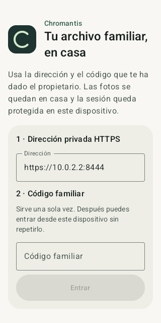
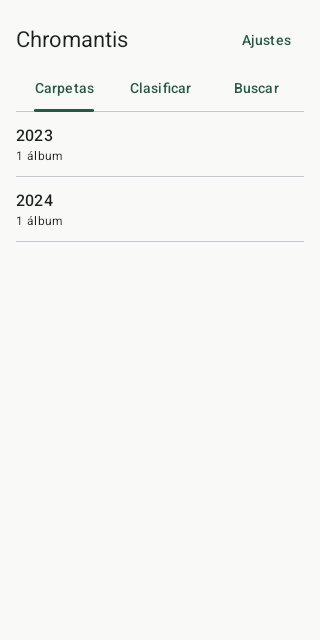
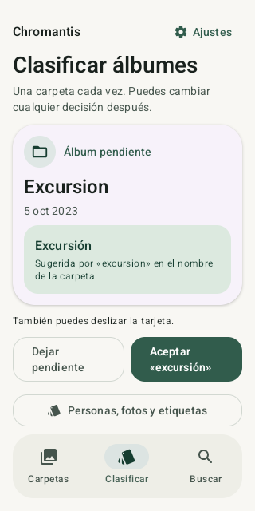
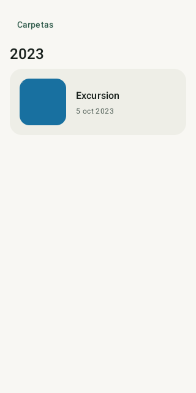
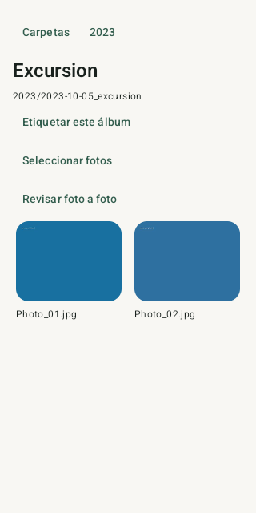
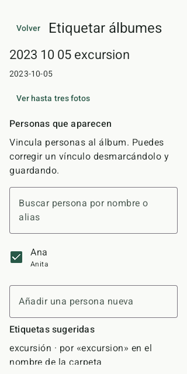
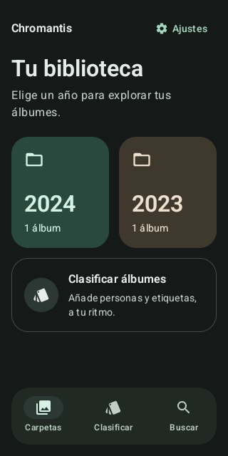
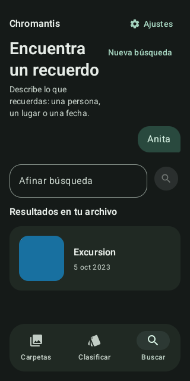

Chromantis for Android is a preview for Android 8.0 and later. It connects to your own Chromantis server over private HTTPS and needs a [family access code](../start/private-access.md#invite-a-family-member-without-telegram).

**APK availability:** Download the latest verified test APK from the workflow artifact or build it locally using the instructions below.

## What you can do

- **Folders** (*Carpetas*) lists years and albums and opens a paged gallery. Visible tiles use thumbnails when enabled on the server. Tap a tile to open the original. Tap **Folders**, the year or the album in the trail to return to that level. **Continue in…** (*Continuar en…*) opens the last gallery visited through Folders at its last loaded page. The shortcut is stored on the device and clears when the family session ends.
- **Organize** (*Clasificar*) shows one album card at a time. Swipe right to accept the visible tag or left to leave the album pending. Both actions have buttons. Open **People, photos and tags** (*Personas, fotos y etiquetas*) to review people by name or alias, see a few photos on demand, or edit tag decisions. Open **Tag this album** (*Etiquetar este álbum*) from a gallery to correct a reviewed album.
- **Search** (*Buscar*) starts with album keywords or a person's name. Send a follow-up such as `antes de 2020` or `con Ana` to narrow the current results. If several albums match a requested name, choose one. The follow-up uses the existing local search rules. To combine topic, person and date in the first request, try `fotos de la playa con Ana antes de 2020`. This form matches people linked to albums, including their aliases. Tap **×** on an active person, year, or album to remove it and keep the other filters.
- In **Search → Tags** (*Buscar → Etiquetas*), choose album tags or manual photo tags. Enter part of a name and tap **Filtrar etiquetas**, then tap a label to open its exact matches. The number beside each label is its result count. On exact album results, use **Afinar búsqueda** with `solo 2024` or `con Ana`. Tap **×** to remove each filter independently. On exact photo results, enter a person’s name or alias to show only photos where they are confirmed. Remove the person chip to see all photos with the tag again. Use **Año del álbum** to apply a four-digit album year. Remove that filter independently of the person filter. Tap a label in an open album to find other albums with that exact tag. Use Back to return to the album. Tap a manual label in the photo viewer to find photos with that exact tag. Use Back to return to the photo. When you return from a result, Android keeps your filters, page and scroll position.

Open **Settings** (*Ajustes*) to choose light, dark, or the Android system appearance. The choice is stored on the device.

Album-search follow-ups also accept `con Ana y Luis` or names separated by commas. The updated local service requires both people to be linked to the album, resolves saved aliases, and keeps the previous search if any name is unknown. Each person remains a separate removable filter.

In an album, select two to four photos and tap **Crear collage** to preview them in selection order. Tap **Guardar collage** to save a new JPEG to the phone gallery. This requires Android 10 or later and server previews.

## A short walkthrough

These screenshots show the redesigned production Compose screens in a disposable test host with synthetic photos. A separate disconnected fixture still checks that metadata search and tagging work without the photo source. They contain no family data. System bars and keyboard placement can differ on your phone.

1. **Connect to the family archive.** Enter the private Chromantis address and the one-time code supplied by the owner. The screen explains that HTTPS is required, photos stay on the household server, and the returning session is protected on this device. Chromantis encrypts that saved session with Android Keystore and the owner can revoke it.



2. **Open Folders.** The library shows years as tiles with indexed album counts. Choose a year, then an album. The three main destinations sit at the bottom, within thumb reach. The year library opens no photos.



3. **Classify one folder.** **Organize** presents one pending album as a focused card. The proposed tag names the folder text that produced it. Swipe is optional: the same accept and leave-pending actions are large buttons, and the full people, photo and tag editor stays one tap away.



This first pass uses only the existing index and folder name. Opening the detailed editor is what requests photo previews; the quick card does not open an image or contact a model.

4. **Open an album.** Album cards show a readable title, date and a cover when one is available.



Covers load only for visible albums after opening a year or search result. They reuse the existing thumbnail cache and fall back to a folder tile if unavailable.



5. **Tag an album.** Open **Tag this album**, select a person by name or alias, and save. Selected people have a clear confirmation and the Save button stays visible while the form scrolls. Search `Anita` from **Search** to find the album. This records an album link, not a person in every photo. Photos stay on demand.



6. **Choose an appearance.** **Settings → Dark** changes the same screens. Light and system appearance are available too.



7. **Ask for a memory.** **Search** starts with examples that can be used as-is or replaced. Your request stays visible above the results. Add a detail in the same field, or remove a person, year or album filter without starting over.



This surface uses the existing deterministic local rules. It does not claim that a model interpreted the request. **Photos by person** remains a separate exact photo-level search from the empty Search screen.

The Compose walkthrough presses the real controls for sign-in, navigation, cover loading, saving without scrolling to the button, alias search and appearance. A separate launcher test opens the exported activity, signs in with its production encrypted preferences, visits an album, recreates the activity, closes it and starts a fresh activity. It follows **Continue in…** back to that album and signs out. This covers activity recreation and a fresh launch on the emulator; it does not simulate full process death or replace testing on a physical phone.

## Session protection

The app encrypts its saved family session with AES-GCM using a device key in [Android Keystore](https://developer.android.com/privacy-and-security/keystore). The encryption authenticates the NAS origin too. Existing saved sessions migrate on first launch; the old plaintext preference is removed after encryption. Session preferences remain excluded from backup and device transfer.

If the device key is unavailable or the saved envelope is damaged, request a new family code. The app does not fall back to plaintext storage. If saving a newly issued session fails, it warns you and lets you continue for that app instance. Signing out or session revocation clears the saved session and album shortcut. Server-side expiry and revocation still apply.

This protects the saved value, not a compromised device or app process. It adds no biometric prompt, external service or NAS workload. Device-backed key creation and recovery still need a physical-device check. On the synthetic fixture, sign in, restart and check that the session resumes; sign out and verify that another code is needed. With a debug build and synthetic data only, inspect the app's preferences: `session_encrypted` should exist, with no `session` plaintext value. Repeat after an in-place upgrade, signed with the same key, from a build that saved the legacy `session` value. Never copy real session credentials into reports.

## Check the index

Open **Settings → Index status** (*Ajustes → Estado del índice*). It shows whether the latest scan is running, completed or failed, and the last successful index date supplied by the server. **Refresh status** (*Actualizar estado*) checks again; the screen does not poll in the background or open photos. With no scan history it says so, and a failed scan does not replace the last successful date.

The family app cannot start a scan. The owner can use **Administration → Find new folders** in the [local web panel](../operate/maintenance.md). Native owner controls remain planned; family curation permission stays limited.

## Tag individual photos

1. Open a gallery and tap **Select photos** (*Seleccionar fotos*) or press and hold a photo. Select the photos on the current page.
2. Tap **Tag photos** (*Etiquetar fotos*). Choose **Add** (*Añadir*) or **Remove** (*Quitar*), then choose an existing person by name or alias, enter a one-word tag, or do both. Confirm to apply the change to the selection. Back exits selection before any change is saved.
3. Open **Search → Photos by person** (*Buscar → Fotos por persona*) and enter a name or alias. These results use confirmations recorded on individual photos. The album search still includes people linked to an album.

To narrow the confirmed photos, enter a one-word manual photo tag in **Etiqueta manual opcional**, then search. For example, use `Anita` and `romería`. Clear the tag field and search again to see all confirmed photos for that person. Changing the person or tag starts from the first results page. This combined filter requires the updated local service that supports `person` together with `tag`.

Photo edits require curation permission. If an indexed photo changes during editing, refresh the gallery and select the photos again.

With thumbnails enabled, **Review photo by photo** (*Revisar foto a foto*) lets you choose one person for a pass through the current gallery page. Swipe right to mark a photo or left to skip it. The buttons do the same. Use **Undo last decision** (*Deshacer última decisión*) to go back one photo. **Save** applies the new links in one batch. Closing the review discards its draft. If a preview is unavailable, you can skip the photo.

The full flow on a current physical phone is pending. The native client in `android/` uses Kotlin and Jetpack Compose with Material 3. Archive access, permissions, indexing, and curation remain in the shared service.

## Build and install

### Download the verified test APK

Open the [Android verification workflow](https://github.com/42Azul/chromantis/actions/workflows/android.yml), choose the latest successful run on `main`, and download `chromantis-debug-<commit>` from **Artifacts**. GitHub requires a signed-in account to download workflow artifacts. The ZIP contains `Chromantis-debug.apk` and `SHA256SUMS.txt`; it expires after seven days.

Verify the download before installing it:

```bash
sha256sum --check SHA256SUMS.txt
adb install -r Chromantis-debug.apk
```

This test APK is signed with the persistent CI testing key. Switching from an APK signed with an earlier debug key requires a one-time reinstall and a new sign-in. Subsequent builds from this workflow can update in place.

### Build it locally

Build on a development computer with JDK 17 or 21, Gradle 8.13, Android SDK Platform 36 and Build Tools 36.0.0. Set `ANDROID_HOME` to the SDK directory. From the repository root:

```bash
gradle -p android spotlessCheck testDebugUnitTest assembleDebug lintDebug
adb install -r android/build/outputs/apk/debug/Chromantis-debug.apk
```

The debug APK is signed by the local debug key. Open it with a private HTTPS origin reachable by the device and a family code. For an HTTPS reverse proxy, follow the [private access settings](../start/private-access.md). Plain HTTP is disabled. The debug build also trusts certificates installed by the Android user for local fixtures. Release builds use the platform trust store. Run `gradle -p android spotlessApply` to format Kotlin with the pinned ktfmt version.

## Test Android Keystore

With a disposable Android emulator or test device connected through `adb`, run:

```bash
gradle -p android connectedDebugAndroidTest
```

Four instrumented tests exercise the actual Android Keystore provider: encrypted persistence with a non-exportable key, legacy preference migration, origin mismatch, and recovery after key deletion. Each test creates a random test-only key alias and preferences file and removes only those resources. No NAS, photos, family credentials or release signing keys are involved.

The [Android verification workflow](https://github.com/42Azul/chromantis/actions/workflows/android.yml) runs these tests on an API 36 emulator, alongside Kotlin formatting, JVM tests, debug APK compilation and lint. After a successful push it retains only the debug APK and checksum for seven days; it uses no build cache and skips execution if the repository becomes private. Emulator results validate the platform integration; they do not establish hardware-backed key protection or complete the physical-phone interaction drill above.

### Native client over HTTPS

The CI suite also runs the Kotlin HTTP client against the real Python service with a disconnected synthetic archive. It checks one-time sign-in, encrypted session restoration, gallery paging, linking Ana, finding the album by alias, and rejection after sign-out. This is a client/service integration test; the visual interaction drill remains pending.

To reproduce it on a disposable emulator, create the temporary certificate shown below, then run this helper instead of the interactive fixture:

```bash
PYTHONPATH=src python tests/android_instrumentation_fixture.py \
  --cert "$fixture_dir/cert.pem" --key "$fixture_dir/key.pem" \
  --config android/src/androidTest/assets/fixture.json
```

In another terminal, run `gradle -p android connectedDebugAndroidTest`. Restart the helper before each run to issue a fresh one-time code. The helper binds only to host loopback and prepares an ignored asset for the test APK. Only the test process trusts that generated certificate; hostname verification stays enabled and the app's certificate rules are unchanged. Ctrl+C removes the asset and temporary fixture. Without the generated asset, the client and Compose tests are skipped; the four Keystore tests still run. Use only disposable emulators and synthetic credentials.


To export the nine synthetic screenshots on a disposable API 29+ emulator, add `-Pandroid.testInstrumentationRunnerArguments.captureScreenshots=true` to the Gradle command. The test writes only its generated PNGs to `Download/chromantis-compose/`; they survive test-app cleanup. Ordinary test runs do not write screenshots to shared storage. CI validates the PNG headers before exporting them.

## Sign a private release

For a private release APK, create a signing key once and keep it outside the repository. Copy `android/keystore.properties.example` to `android/keystore.properties`, use the absolute path to that key, and replace every placeholder. The local properties file, `.jks` files, and `.keystore` files are ignored by Git. Build and verify the signed artifact:

```bash
keytool -genkeypair -v -keystore /private/path/to/chromantis-release.jks \
  -alias chromantis -keyalg RSA -keysize 3072 -validity 10000
gradle -p android spotlessCheck testDebugUnitTest assembleRelease lintRelease
apksigner verify --verbose android/build/outputs/apk/release/Chromantis-release.apk
```

Back up the keystore and its passwords privately. Android updates must be signed with the same key. For CI or another trusted build host, leave `keystore.properties` absent and provide `CHROMANTIS_KEYSTORE_PATH`, `CHROMANTIS_KEYSTORE_PASSWORD`, `CHROMANTIS_KEY_ALIAS`, and `CHROMANTIS_KEY_PASSWORD` instead. If Gradle cannot find `assembleRelease`, check that all four signing values are set. Without them, the release variant is disabled and the general `assemble` command builds only the debug APK.

## Test with a synthetic archive

For a local emulator smoke test, install the existing thumbnails extra for Pillow. Generate a temporary certificate for the emulator's host alias and run the fixture without the NAS:

```bash
fixture_dir=$(mktemp -d)
openssl req -x509 -newkey rsa:2048 -nodes -days 1 -subj /CN=Chromantis-Fixture \
  -addext 'subjectAltName=IP:10.0.2.2' \
  -keyout "$fixture_dir/key.pem" -out "$fixture_dir/cert.pem"
PYTHONPATH=src python tests/android_fixture.py \
  --cert "$fixture_dir/cert.pem" --key "$fixture_dir/key.pem"
```

Install the temporary certificate as a trusted user CA on the disposable emulator. Set the address to `https://10.0.2.2:8443` and use the fixture's printed one-time code. Open 2024, browse the second gallery page, open a photo, and rotate the device. Check that the same photo remains open and that going back returns to the second page. Relaunch the app to check the retained session.

To check the same fixture over HTTPS without opening the app, run `PYTHONPATH=src python -m unittest discover -s tests -p test_android_fixture.py -v`.

From **Organize**, swipe left on the first card, then use **Start again** (*Volver al principio*) at the end of the queue to revisit it. In **Folders**, open the 2024 beach album and choose **Tag this album**. Find `Anita`, select Ana, and save. Open **Search**, search `fotos de la playa con Anita antes de 2025` and check that the two filters appear. Remove the year with **×** and check that the person filter still applies.

On a fresh fixture with `--index-only`, swipe right on a suggested tag. The app shows the next suggestion for that album, or advances when all suggestions are decided. Open the tagged album from **Folders** and check the decision in **Tag this album**. Try the buttons and the swipes with the synthetic archive disconnected.

To check individual tagging, select photos 1 and 3 in the 2024 album and add Ana. Search for `Anita` under **Photos by person** and check that exactly those two appear.

Add the manual tag `romería` to photos 2 and 3. Search `Anita` with `ROMERIA` in the optional tag field and confirm that photo 3 is the only result: photo 1 has Ana but no tag, and photo 2 has the tag but no Ana. Change the tag to `unknown` and confirm the empty result. Clear the tag and search again to restore photos 1 and 3. Remove Ana from photo 1 and search again; only photo 3 should remain. Press Ctrl+C in the fixture terminal to remove its temporary SQLite index and photos.

To try reviewing by gesture, run a fresh fixture with the synthetic archive connected. In **Review photo by photo**, choose Ana, mark photo 1, skip photo 2, mark photo 3, undo and skip photo 3. Save and check that the confirmed search returns just photo 1. Repeat with the batch editor and compare time and missed or incorrect selections.

To check the folder trail, open the second gallery page in 2024 and open a photo. Tap the album in the trail to go back to page two, then tap **Folders** to reach the year list in one step. Close and reopen the app and tap **Continue in…** to return to page two. If a reindex removed that page, the shortcut opens the first available page instead.

To test revocation, run the command below in a second terminal using the fixture's printed **SQLite** path and **Family access ID**. Then open another year in the app and check that it asks for a new code.

```bash
SOURCE_TYPE=local SOURCE_ROOT=/tmp SQLITE_PATH=/tmp/chromantis-android-EXAMPLE/index.db \
  python scripts/family_access.py revoke 1
```

On Android 10 and newer, open a photo and choose **Guardar original** to save a copy under **Pictures/Chromantis**. The app downloads the original on demand, with a 32 MiB limit.

In the photo viewer, choose **Compartir** to open Android's share sheet with the original. Select an app and confirm there when you want to send it. Sharing prepares a private temporary copy and supports originals up to 32 MiB.

In the gallery, choose **Seleccionar fotos** and mark up to ten photos. Tap **Compartir selección** to prepare their originals (32 MiB total) and open Android's share sheet. You can cancel preparation or change the selection and retry if it is too large.

On Android 10 and newer, **Guardar selección** saves the marked originals to **Pictures/Chromantis**. Each attempt handles up to ten photos and 32 MiB. If you cancel or a file fails, keep the same selection open and retry to save the remaining files.

## Physical-phone release checks

Use the same APK for every row and record its build or commit, the Android version, the device model and the date. Use a disposable family invitation and synthetic photos served on a private network. Keep addresses, codes and photo contents out of the results. Record **Pass**, **Fail** or **N/A** for each row and explain any N/A. Keep a required check open until it has been run.

| Check | Expected result | Result |
| --- | --- | --- |
| Redeem an invitation, then try it again in a separate session. | The first sign-in works and the second redemption is refused. | |
| Open gallery page two, rotate the phone and return from a photo. | The album and page are preserved. | |
| Open another app, terminate the background Chromantis process and start Chromantis from its launcher. Record whether the process was actually terminated. | The family session still works and **Continue in…** opens the saved gallery page. | |
| Revoke the test session and open a different year. | The next protected request asks for a new code. A new invitation restores access. | |
| Disconnect Wi-Fi or stop the fixture while opening an uncached preview, then restore it. | The failed request is visible and retry loads the preview. | |
| Deny local-network access where Android provides that control, then grant it. | The app recovers and can open a photo after access is restored. | |
| Browse the year with the two split-year branches with the fixture started using `--split-year`. | The two same-title albums open as separate galleries, including an album on a later page. | |
| Open a cover, save one original and a selection, and share a synthetic photo through the Android share sheet. | The cover appears, saved files open in the phone gallery, and the receiving app opens the shared photo. | |

For each failure, record the shortest reproduction, what appeared on screen and who will follow up. Leave any row unrun if the fixture or device cannot exercise it.
