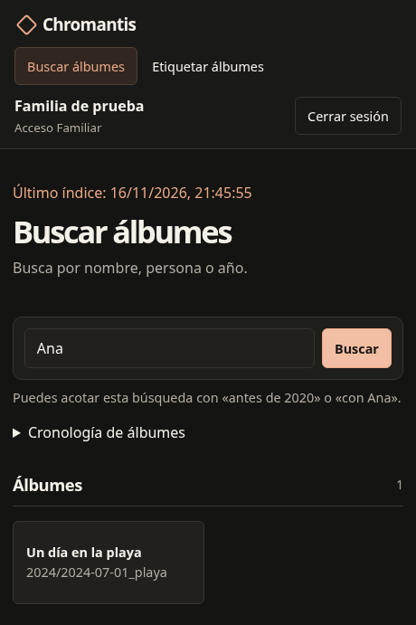
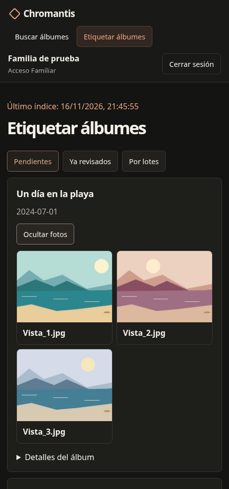

Open the local Chromantis address and [sign in](../start/private-access.md). The browser works on a phone or computer.

The screenshots show the browser on a phone-sized screen with a sample archive.

## Find an album

In a family session, open **Buscar álbumes** to browse by year or search by folder words, title, alias, place, or person. Try `playa 2024` or `Ana`. Open an album for its photos and use the viewer to open or download an original. The [optional thumbnail cache](../operate/maintenance.md#load-small-previews-on-demand) keeps the grid light on mobile.

Use the album timeline to browse by place or date. A date can come from the indexed folder or a saved correction. The photo viewer shows camera-reported and file modification dates separately when available.

To narrow the current search, follow up with `before 2020`, `only 2019`, or `with Ana`. Choose an album if several match. A fresh query starts a new search.

## Tag your first album

1. Open **Tag albums** (*Etiquetar álbumes*) and select a pending album. Its title and known date appear first.
2. Search for **Ana** or a saved alias. Select her, choose other people, or add a new person. Use **View up to three photos** if you need a reminder.
3. Accept, reject, or correct the folder-name suggestions. You can also add one-word manual tags.
4. Choose **Save and next** (*Guardar y siguiente*). Open **Buscar álbumes** and search for `Ana` to find the album.

To check the album before saving, choose **View up to three photos**. Tap a preview to open the original.

An album link records that someone appears somewhere in the album. To mark the exact photos where someone appears, use [individual photo tagging in Android](android.md#tag-individual-photos) or the [manual photo tagging API](../reference/api.md#manual-photo-tagging-api).

Use **Saltar** to leave a doubtful album pending. To correct a link in a family session, find the album by its title in **Buscar álbumes** and open the result. Tap **Ana ×** under the selected people, then choose **Guardar y siguiente**. You can also open reviewed albums from **Ya revisados**.

## Review suggestions in batches

Open **Batch review** (*Por lotes*) to group albums by a repeated suggestion. Every suggestion shows the matching word from the folder name. Accept it for some albums, reject it for others, and leave uncertain ones pending. Use **Review** for individual corrections.

The group saves together. If one album changed in the meantime, reload and decide again. This workflow uses the folder names in SQLite and requests no photos. Decisions and manual tags survive reindexing when the album path stays the same. A move or rename creates a new indexed album, and the original folder words remain searchable after a suggestion is rejected.

## Edit album details

Open **Album details** (*Detalles del álbum*) to add a note, place, or up to eight aliases, or to correct the title and date. Clear a correction to restore the indexed value. The corrected year is used for year browsing. Both the original folder title and alternate names remain searchable.

## Save a private collection

In an owner session, choose **Add photo to collection** or **Add album to collection**, then pick an existing collection or create one. Open **Collections** to revisit entries or remove them. Owners have separate collections, with up to 100 collections and 250 entries in each. An entry becomes available again when the same path and archive root return to the index.

To let someone else view an album, use a [revocable album link](../start/private-access.md#share-one-album).
