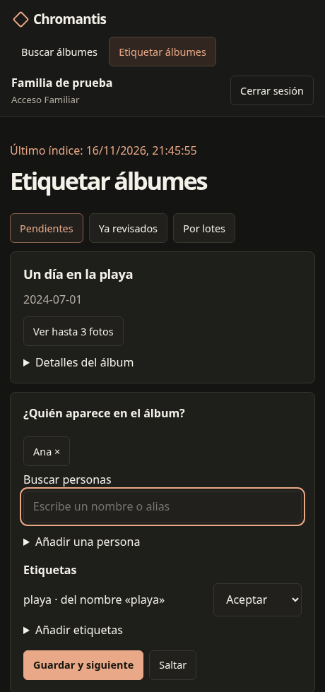
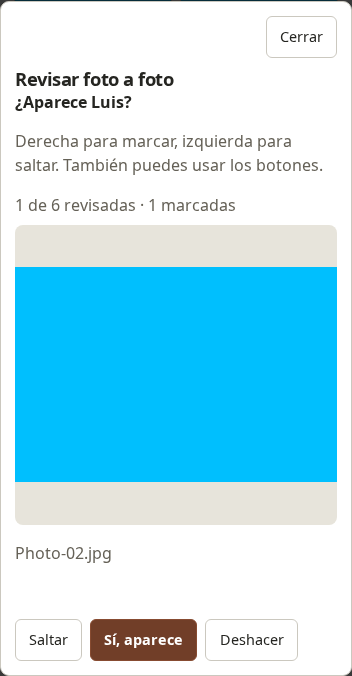

Open the local Chromantis address and [sign in](../start/private-access.md). The browser works on a phone or computer.

Choose **Appearance** in the sidebar for **System**, **Light**, or **Dark**. In a family session, the control is labelled **Aspecto**. Your choice is saved on this browser. **System** follows the device appearance.

The screenshots show the browser on a phone-sized screen with a sample archive. The light-theme photo examples use blue tiles and fictional names.

## Find an album

In a family session, open **Buscar álbumes** to browse by year or search by folder words, title, alias, place, or person. Try `playa 2024` or `Ana`. Open an album for its photos and use the viewer to open or download an original. The [optional thumbnail cache](../operate/maintenance.md#load-small-previews-on-demand) keeps the grid light on mobile.

Choose **Explorar por año** to see the indexed years and their album and photo counts. Open a year, then an album. **Página siguiente** shows more albums and **Volver a años** returns to the year list. After reviewing an album, **Volver a resultados** restores the same page. This navigation works with the photo archive disconnected.

Use the album timeline to browse by place or date. A date can come from the indexed folder or a saved correction. The photo viewer shows camera-reported and file modification dates separately when available.

To narrow the current search, follow up with `before 2020`, `only 2019`, or `with Ana`. Choose an album if several match. A fresh query starts a new search. Try `fotos de la playa con Ana antes de 2020` to set a person and year at once. Tap **×** beside an active person, year, or album to remove just that filter.

After starting an album search, send `con Ana y Luis` (or `with Ana and Luis`) to require links for both people in the same album. Commas and saved aliases work too, and repeated aliases for one person are counted once. You can also use `fotos de la playa con Ana y Luis antes de 2020` as the first request. Unknown names reject the whole refinement and leave the previous search in place. Each person has a removable filter. These are album-level links; use **Fotos por persona** for individual photo confirmations.

Open **Etiquetas** in **Buscar álbumes** and choose **Etiquetas de álbumes** or **Etiquetas manuales de fotos**. Each label shows its result count. Select one to search for exact matches of that type. Use the active filter button to clear an album tag. Enter part of a name and choose **Filtrar etiquetas** to narrow the full catalog. If an album tag is active, enter a year or another search term and choose **Buscar** to narrow those results. You can also select a label from an open album to find other albums with that tag. In the photo viewer, select a saved manual label to find other photos with the same label. Use **solo 2003** or **con Ana** to add a removable year or person filter to a tag search.

## Find photos by person

Under **Buscar álbumes**, change the result type to **Fotos por persona** and search a name or alias. Results include individually tagged photos from the web or [Android](./android.md#tag-individual-photos). Use **Álbumes** to search by album links. Previews appear when the thumbnail cache is enabled. Tap a result to open its original.

Use **Etiqueta manual opcional** to narrow that person's photos to one manual photo tag. For example, search `Ana` with `romería`. Clear that field to see all photos confirmed for Ana again.

With a curator account, choose **Etiquetar foto** to add or remove people on that specific photo. The same action is available under **Ver fotos del álbum** in the album editor. Pick a name or alias and choose **Guardar cambios**. If you remove the person you were searching for, the photo leaves those results.

For a manual photo tag, choose **Fotos por etiqueta** and enter one exact tag such as `romería`. The search matches the whole tag and ignores accents and case. If you remove the tag from a result, that photo leaves the list.

To classify several search results together, choose **Seleccionar fotos**, mark only the photos you want, or use **Seleccionar esta página** and uncheck doubtful photos. **Etiquetar fotos** opens the same batch editor as the gallery. The batch can span albums; each result shows its album path and the editor includes paths to distinguish repeated filenames. Save once to add or remove people and manual tags. The search keeps its person, tag and page, returning to an earlier page if edits empty the current one. Canceling or changing pages clears the selection without saving. This flow also works from the index with previews disabled and the archive disconnected.

Open an album result, or choose **Ver álbum** on a photo result, to browse its gallery. Choose **Etiquetar álbum** to open the editor if you have curation access. **Volver a resultados** and **Guardar y volver a resultados** restore the same search and page.

## Tag your first album

1. Open **Tag albums** (*Etiquetar álbumes*) and select a pending album. Its title and known date appear first.
2. Search for **Ana** or a saved alias. Select her, choose other people, or add a new person. Use **Ver fotos del álbum** if you need a reminder.
3. Accept, reject, or correct the folder-name suggestions. You can also add one-word manual tags.
4. Choose **Save and next** (*Guardar y siguiente*). Open **Buscar álbumes** and search for `Ana` to find the album.

The album header shows its indexed folder below the date or year. Use it to distinguish albums with the same title before tagging them.

The save and skip actions stay at the bottom of the view as you scroll through the editor. After saving or skipping, keyboard focus moves to the next album title.

Choose **Ver fotos del álbum** to browse six photos at a time. Use **Más fotos** and **Fotos anteriores** to move through the album. When the thumbnail cache is off, start with filenames and use **Abrir foto** to load an original. Browsing keeps your unsaved album edits.

## Tag individual photos

To edit several photos together, choose **Seleccionar fotos**, mark the photos on the current page, then choose **Etiquetar fotos**. Review the filenames and pick the people to add or remove. Under **Etiquetas manuales**, enter one-word tags separated by commas or mark existing tags for removal. Save once to apply the changes to the selected photos. You can use **Etiquetas manuales** on a single photo too. Changing pages clears the photo selection.

## Review one photo at a time

With thumbnails enabled, **Revisar foto a foto** reviews the current gallery page for one person. Choose their name or alias and press **Empezar**. Swipe right or use **Sí, aparece** to mark a visible photo. Swipe left or use **Saltar** to leave it for another pass. **Deshacer** revisits the previous decision. Check the marked filenames and choose **Guardar revisión** at the end. Closing before saving discards this review.

An album link records that someone appears somewhere in the album. To mark the exact photos where someone appears, use **Etiquetar foto** or [individual photo tagging in Android](./android.md#tag-individual-photos).

Use **Saltar** to leave a doubtful album pending. To correct a link in a family session, find the album by its title in **Buscar álbumes** and open the result. Choose **Etiquetar álbum**. Tap **Ana ×** under the selected people, then choose **Guardar y volver a resultados**. The search refreshes and the album drops out if it no longer matches. Choose **Volver a resultados** to leave the editor without saving your people and tag changes. You can also open reviewed albums from **Ya revisados**. If saving succeeds but the results fail to refresh, choose **Reintentar la búsqueda** to rerun the same search without sending the edit again.

## Review suggestions in batches

Open **Batch review** (*Por lotes*) to group albums by a repeated suggestion. Every suggestion shows the matching word from the folder name. Choose **Aceptar**, **Corregir** or **Rechazar** by album. Enter a replacement tag for each correction. Leave uncertain albums pending and use **Review** (*Revisar*) to open the full editor. Choose **Guardar y volver al lote** to save the correction or **Volver a Por lotes** to return without saving it. Your batch selections are restored if they are still valid. In a group, **Aceptar los pendientes** and **Rechazar los pendientes** fill only the rows you have left undecided. Check the count and adjust any row before choosing **Guardar decisiones**.

The group saves together. Selections in other groups stay selected after saving when the suggestion is still pending and the album has the expected revision. If the save succeeds but the queue fails to load, use **Reintentar la carga** to recover those selections and refresh the queue. If the queue reports that a selection changed, review it again before saving. This workflow uses the folder names in SQLite and requests no photos. Decisions and manual tags survive reindexing when the album path stays the same. A move or rename creates a new indexed album, and the original folder words remain searchable after a suggestion is rejected.

## Edit album details

Open **Album details** (*Detalles del álbum*) to add a note, place, or up to eight aliases, or to correct the title and date. Clear a correction to restore the indexed value. The corrected year is used for year browsing. Both the original folder title and alternate names remain searchable.

## Save a private collection

In an owner session, choose **Add photo to collection** or **Add album to collection**, then pick an existing collection or create one. Open **Collections** to revisit entries or remove them. Owners have separate collections, with up to 100 collections and 250 entries in each. An entry becomes available again when the same path and archive root return to the index.

To let someone else view an album, use a [revocable album link](../start/private-access.md#share-one-album).

Open a photo and choose **Compartir** to pass the loaded original to the device's share sheet when the browser supports file sharing. **Descargar original** saves the same file on browsers with or without sharing.

With photos selected, choose **Preparar para compartir**. Once the files are ready, choose **Compartir selección** to open the device menu. **Descargar selección** saves a ZIP when the device cannot share the selected files.

In the album gallery, select photos on the current page and choose **Descargar selección** to save their originals as a ZIP. If the selection exceeds 16 MiB, mark fewer photos and retry. **Cancelar selección** cancels the download in the browser and clears the selection.

**Descargar álbum** includes all indexed photos in the album, including pages you have yet to open. If the normal ZIP exceeds 20 photos or 16 MiB, choose **Confirmar descarga grande** to try up to 100 photos and 64 MiB total, with at most 16 MiB per photo. **Cancelar transferencia** stops the browser request. If the album exceeds the larger limit, use selections or download individual originals.

If an album save fails, the message beside **Guardar** explains what happened. Keep the editor open to retry with the same selections. If the album was saved and the next one fails to load, choose **Reintentar la carga** to continue from the same point. This retries only the read.

If someone else saves changes to the same album while you are editing, your draft stays visible. Choose **Descartar mis cambios y recargar** to open the latest saved version, then reapply the changes you still want.
